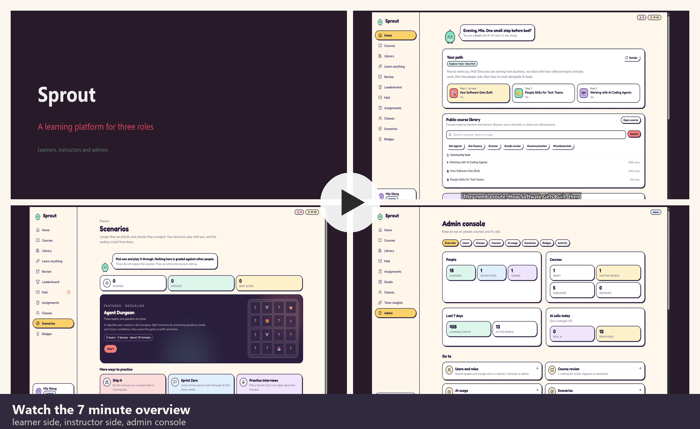

# Sprout · COMP5241 group 19

A learning platform prototype with three roles: learners, instructors and admins.

## Links

| What | Where |
|---|---|
| **Deployed app** | https://gen-ai-learning-platform-prototype.vercel.app |
| **GitHub repository** (public) | https://github.com/ssyu3876/GenAI-learning-platform-prototype |
| **Overview video** (7 min) | [Watch on YouTube](https://youtu.be/v0ja5RL-34c) |
| **Video preview** |  |
| **Final report** (PDF) | [report.pdf](report.pdf) |
| **Presentation slides** (PDF) | slides.pdf |

## Demo accounts

All of them use the password `sprout123`.

| Role | Email | What you can do |
|---|---|---|
| Learner | `learner@demo.dev` | Courses, activities, review, scenarios, badges |
| Instructor | `instructor@demo.dev` | Studio, classes, assignments, tutor insights |
| Admin | `admin@demo.dev` | The eight page admin console |

## What the video covers

Seven minutes. The first half is the learner side: the three step path, the public course library,
a lesson with its quiz, the review queue, assignments, mail, badges and the four scenario exercises.
The second half is the instructor side and the admin console.

## Where to start in the app

- **Learner**: Home shows the three step path. Scenarios holds four longer exercises. Review holds
  the questions this account got wrong.
- **Instructor**: Studio creates courses, Classes organises students, Tutor insights shows what the
  class asks Pip.
- **Admin**: the Admin page opens the console. Try approving a course, or closing a scenario.

## Demo data

Six published courses, one class with nineteen accounts, and 881 learning events. The screenshots
in the report come from the same demo data.
